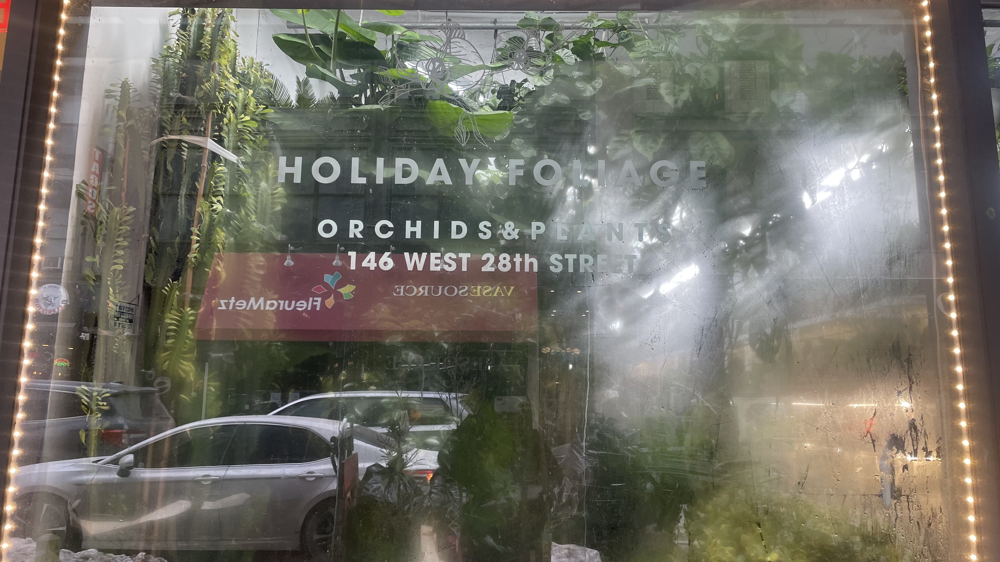

# Houseplant Health Classification with Amazon Rekognition

Nurseries and plant retailers lose inventory when sick plants go unnoticed. This project classifies houseplant photos as healthy or unhealthy using Amazon Rekognition Custom Labels, served through AWS Lambda. Missing a sick plant costs more than a false alarm, so recall on the unhealthy class mattered more than overall accuracy.

## Key results
On a holdout set of 19 images (14 healthy, 5 unhealthy):

| Metric | Healthy | Unhealthy |
|--------|---------|-----------|
| Precision | 0.93 | 1.00 |
| Recall | 1.00 | 0.80 |
| F1 | 0.97 | 0.89 |
| **Accuracy** | **0.95** | |

- The model made one error: it classified one unhealthy plant as healthy. That is the costlier kind of mistake, so recall on the unhealthy class is the number to improve.
- It never flagged a healthy plant as unhealthy (precision 1.00).
- The test set is small (5 unhealthy images), so these numbers are indicative, not definitive.

## Approach
Local images → S3 → Rekognition Custom Labels training
New image → S3 (`uploads/`) → Lambda → Rekognition inference → S3 (`results/`)

- **Managed service over a custom CNN:** I used Rekognition Custom Labels to get a production-style, serverless pipeline rather than building computer-vision infrastructure from scratch.
- **Self-collected dataset:** 91 photos (67 healthy, 24 unhealthy) taken of my own plants and at two plant shops.
- **Stratified 80/20 split:** done before augmentation, so the test images stay untouched.
- **Augmentation on the training set only:** I used Albumentations to expand it to 201 images and reduce the healthy/unhealthy imbalance.
- **Provisioned in code:** S3, Rekognition, Lambda and IAM were all set up with Boto3 from one notebook, including a cleanup cell to tear them down.

## Challenge
With 67 healthy vs. 24 unhealthy images, the model risked defaulting to "healthy." Augmenting the training set was aimed at that imbalance, not just at growing the dataset. The one remaining miss shows the problem is reduced, not solved. More unhealthy examples would be the next step.

## Run it
1. Clone the repo and add images to `data/healthy/` and `data/unhealthy/`
2. `pip install boto3 Pillow scikit-learn albumentations matplotlib pandas numpy tqdm torch torchvision`
3. Configure the AWS CLI (Python 3.11+), then run the notebook top to bottom
4. Run the cleanup cell at the end to tear down AWS resources

**Dataset:** [Houseplant Health Classification Dataset on Kaggle](https://www.kaggle.com/datasets/tarieretimitimi/houseplant-health-classification-dataset)

## Stack
Python · Amazon Rekognition Custom Labels · S3 · Lambda · IAM · Boto3 · Albumentations · scikit-learn

## Acknowledgements
Training images were collected at two plant shops whose staff kindly allowed photography:
- **Holiday Foliage Orchids and Plants**, 146 West 28th Street, New York, NY
- **Redwood Flower Shop**, New Brunswick, NJ
